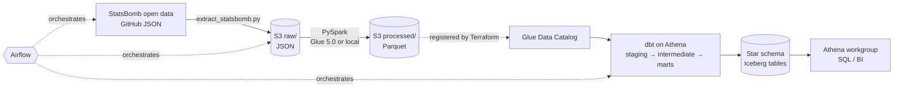
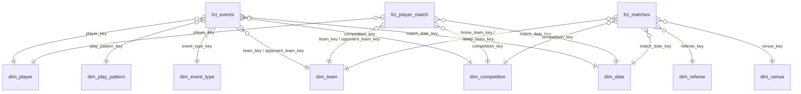
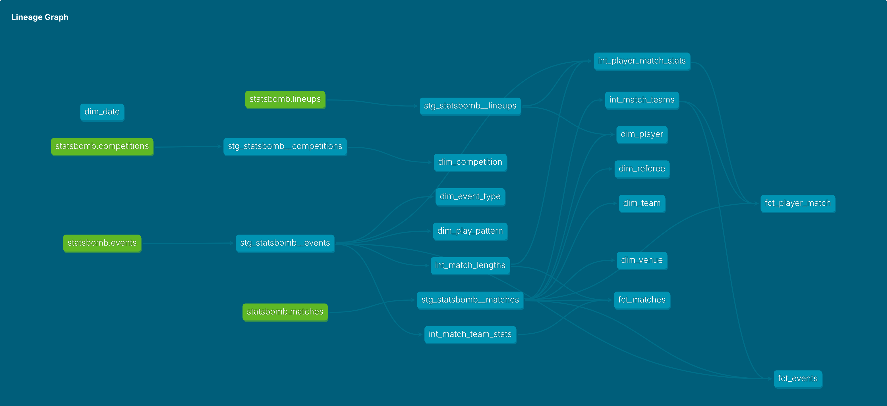

# Sports Analytics ELT Pipeline ⚽️

An end-to-end ELT pipeline that ingests [StatsBomb open data](https://github.com/statsbomb/open-data), transforms it with **PySpark**, models it into a tested **dbt star schema**, and serves it through **AWS Athena**. All the infrastructure is defined in **Terraform**, and **Apache Airflow** orchestrates the runs.

The whole pipeline also runs **locally with no AWS account**: Spark reads and writes a local folder, and dbt targets DuckDB. CI uses this to run the full pipeline on real data for every PR.

## 📌 Project status

| Part | Status |
|---|---|
| Extract → PySpark → dbt star schema | ✅ Runs end to end locally and in CI on real StatsBomb data; all 165 dbt checks pass |
| Airflow DAG and Docker image | ✅ DAG integrity tests and the image build run in CI |
| Terraform | ⚠️ **Validated, not deployed.** CI runs `terraform fmt -check` and `terraform validate`, but `terraform apply` has not been run against a real AWS account |
| Glue job and Athena (dbt `athena` target) | ⚠️ **Untested on AWS.** The same Spark script runs locally and the dbt project parses under the Athena adapter, but neither has run on Glue or Athena |

Things to verify on a first real deploy: IAM permissions for the Glue job and for dbt on Athena, Iceberg table creation by dbt-athena, and Glue 5.0 reading the raw JSON from S3.

## 🏗️ Architecture



| Layer | Tech | What it does |
|---|---|---|
| Orchestration | Airflow 2.10 (Docker) | `extract_raw → spark_transform → dbt.deps → dbt.source_freshness → dbt.build` |
| Extract | Python, requests, boto3 | Competitions, matches, events and lineups for configurable competition-seasons. Incremental, retried, parallel. |
| Transform | PySpark 3.5 | Explicit schemas, flattens nested JSON, primary-key quality gates, typed Parquet. Runs on **AWS Glue** or `spark-submit`. |
| Model | dbt 1.11 (Athena / DuckDB) | Staging views, intermediate views, star-schema marts, 140+ data tests, unit tests |
| Infra | Terraform (AWS provider 6) | S3, Glue Catalog and job, Athena, IAM, CloudWatch |
| Serving | Athena engine v3 | Workgroup with a per-query scan limit and saved example queries |

## ⭐ Star schema



| Fact | Grain | Example measures |
|---|---|---|
| `fct_events` | one on-pitch event | location, end location, xG, shot distance, `is_pass` / `is_goal` / `is_key_pass` (0/1, additive) |
| `fct_player_match` | player × match (full squad) | minutes played, passes, pass completion, shots, goals, xG, assists, tackles, pressures, cards |
| `fct_matches` | match | score, result, team shots / xG / passes, extra time / penalties flags |

Design choices:
* **Surrogate keys** come from `dbt_utils.generate_surrogate_key`. Natural ids stay on every dimension.
* **Unknown members**: each dimension has an `Unknown` row (id `-1`), and the facts map missing keys to it. A fact foreign key is therefore never NULL, and every join is a safe inner join.
* **Conformed dimensions**: `dim_date`, `dim_team`, `dim_player` and `dim_competition` are shared by all three facts.
* **Role-playing dimensions**: `dim_team` plays home, away, team and opponent.
* **Degenerate dimensions** such as `match_id`, `period` and `competition_stage_name` live on the facts.
* **Penalty shoot-outs** (period 5) are excluded from goals and xG, so the event-level goals match the published score. A singular test checks this.

### dbt lineage

Sources (green) flow through staging and intermediate views into the dimensions and facts. Tests are hidden for readability. Run `make dbt-docs` to explore it interactively.



### Example query

Top scorers at the 2018 World Cup, from the star schema (DuckDB, full tournament):

```sql
select p.player_display_name, t.team_name,
       sum(f.goals) as goals, round(sum(f.xg), 2) as xg,
       sum(f.assists) as assists, cast(round(sum(f.minutes_played)) as int) as minutes_played
from statsbomb_marts.fct_player_match f
join statsbomb_marts.dim_player p on p.player_key = f.player_key
join statsbomb_marts.dim_team   t on t.team_key   = f.team_key
group by 1, 2
order by goals desc, xg desc
limit 5;
```

| player_display_name | team_name | goals | xg | assists | minutes_played |
|---|---|---|---|---|---|
| Harry Kane | England | 6 | 4.03 | 0 | 591 |
| Antoine Griezmann | France | 4 | 3.56 | 2 | 583 |
| Cristiano Ronaldo | Portugal | 4 | 2.7 | 0 | 383 |
| Romelu Lukaku | Belgium | 4 | 2.61 | 0 | 490 |
| Kylian Mbappé | France | 4 | 1.78 | 0 | 552 |

Kane's 6 goals match his real 2018 Golden Boot.

## 🧪 Testing

| Where | What |
|---|---|
| `spark/tests` (pytest) | Each transformation runs on hand-built StatsBomb payloads. These tests cover flattening, nullable sub-objects, short coordinate arrays, minutes, cards and the quality gates. **Each output schema is asserted column-for-column against `contracts/processed_tables.json`**, the same file Terraform uses to create the Glue tables, so Spark and the catalog can't drift. |
| `tests/` (pytest) | Extractor (HTTP mocked): S3/local layout, incremental skip, `--force`, non-zero exit on failure. DAG integrity: imports cleanly, task order, runner switching. |
| dbt data tests | `unique` / `not_null` on every key, `relationships` on **every fact foreign key**, accepted values and ranges (xG 0–1, minutes 0–135), and a custom `pitch_coordinate` generic test |
| dbt singular tests | Score reconciles with goal events. Exactly 11 starters per side. xG agrees across the three fact grains. |
| dbt unit tests | Match result derivation, and minutes played for the final-whistle and unused-sub cases |
| CI | Lint, then unit tests, DAG checks, a **real end-to-end run** (extract → Spark → `dbt build` on DuckDB), `terraform fmt` + `validate`, and the image build |

## 🚀 Running it

### 1. Fully local (no AWS)

```bash
python3.11 -m venv .venv && source .venv/bin/activate
make install
make pipeline                       # extract 8 World Cup matches -> Spark -> dbt build
make pipeline MAX_MATCHES=0         # ...or the whole tournament (64 matches, ~230k events)
make dbt-docs                       # lineage graph at http://localhost:8081
```

The marts end up in `dbt/statsbomb.duckdb` (schema `statsbomb_marts`).

### 2. Airflow in Docker

```bash
cp .env.example .env                # defaults = local mode
make up                             # http://localhost:8080  (airflow / airflow)
```

Unpause and trigger `statsbomb_elt`.

### 3. On AWS

> ⚠️ This path has not been run yet: the Terraform is validated in CI but has never been applied. See [Project status](#-project-status).

```bash
cp terraform/environments/dev.s3.tfbackend.example terraform/environments/dev.s3.tfbackend   # edit state bucket
make tf-init tf-plan tf-apply TF_ENV=dev
terraform -chdir=terraform output -raw dotenv >> .env      # Glue job, Athena, schema prefix ...
```

Then run the DAG with `SPARK_RUNNER=glue` and `DBT_TARGET=athena`. Use credentials that can assume `pipeline_role_arn`. Terraform never creates access keys.

Terraform provisions:
* **S3** lake, Athena-results and artifacts buckets: encrypted, public access blocked, TLS-only, with lifecycle rules. The lake bucket is versioned and moves raw data to Standard-IA after 30 days.
* **Glue Catalog** databases for the `processed`, `staging`, `intermediate` and `marts` layers, plus the processed tables generated from the schema contract.
* **Glue 5.0 job** that runs the exact same `spark/jobs/statsbomb_transform.py`, with continuous logging and the Spark UI enabled.
* **Athena** workgroup (engine v3, enforced results location, per-query scan cutoff) with saved example queries.
* **IAM**: a least-privilege Glue role (read `raw/`, write `processed/`) and a pipeline role/policy for Airflow.

## ⚙️ Configuration

| Variable | Default | |
|---|---|---|
| `STATSBOMB_COMPETITIONS` | `43:3` | `competition_id:season_id` pairs, comma separated |
| `STATSBOMB_MAX_MATCHES` | – | Cap per season (dev/CI) |
| `LAKE_ROOT` | `./data_lake` | Local path or `s3://bucket` |
| `SPARK_RUNNER` | `local` | `local` (spark-submit in the worker) or `glue` |
| `DBT_TARGET` | `duckdb` | `duckdb` or `athena` |
| `DBT_SCHEMA_PREFIX` | `statsbomb` | Must match the Glue database prefix (`terraform output`) |

## 📁 Layout

```
contracts/processed_tables.json   schema contract shared by Spark tests + Terraform
dags/statsbomb_elt_dag.py         Airflow DAG
scripts/extract_statsbomb.py      extract -> raw zone
spark/jobs/statsbomb_transform.py PySpark job (local or Glue)
spark/tests/                      PySpark unit tests
dbt/models/staging/               1:1 cleaned views over the processed tables
dbt/models/intermediate/          reusable joins and aggregations
dbt/models/marts/core/            dim_* and fct_* (star schema) + unit tests
dbt/tests/                        singular tests + custom generic test
terraform/                        AWS infrastructure
docker/airflow/                   Airflow image (Java, PySpark, dbt venv)
```

## Notes

* The Spark job does a **full refresh**: the raw zone keeps the complete history, so every run rebuilds the processed zone deterministically. A natural next step is to partition the events by competition-season and make `fct_events` an incremental Iceberg `merge`.
* Data is © StatsBomb, provided under their [open data licence](https://github.com/statsbomb/open-data/blob/master/LICENSE.pdf). Credit StatsBomb if you publish analysis built on it.
